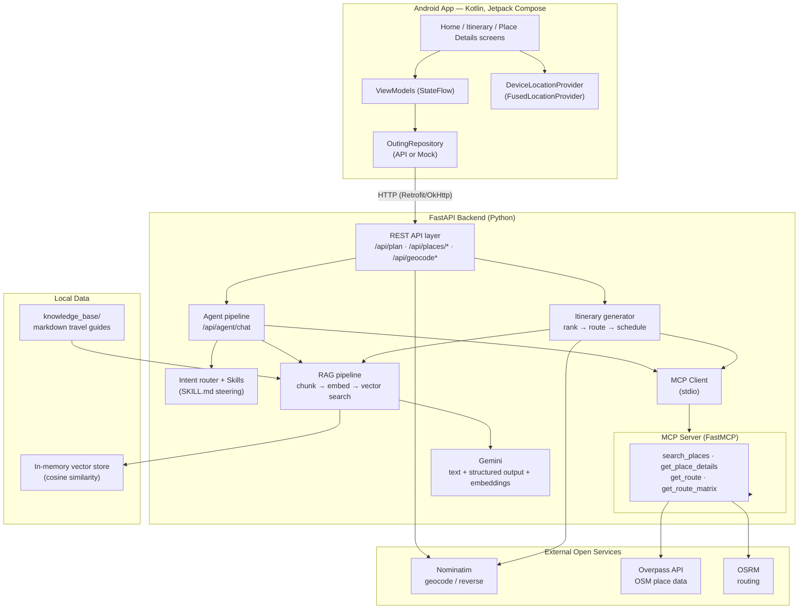

<div align="center">

# 🗺️ PlaceExplorer

**AI-Powered Outing Planner**

Turn "what should we do today?" into a timed, road-realistic day plan — powered by Gemini, RAG, MCP and live OpenStreetMap data.

[](#testing)
[](#android-architecture--technology-stack)
[](#backend-architecture--technology-stack)
[](#known-limitations)

</div>

---

> **Repository:** https://github.com/DeVentures7/dlpdubey7-placeexplorer
>
> ⚠️ **Project status:** PlaceExplorer is a **development-stage portfolio project**, not production software. See [Known Limitations](#known-limitations) before relying on anything it produces.

---

## 1. Project Overview & Problem Statement

Planning a day out usually means juggling five browser tabs: one for attractions, one for "is it open?", one for restaurants nearby, and a maps tab to guess how long each hop actually takes. Generic "top 10 in X" lists don't know where *you* are starting from, how long you have, or what you actually like.

**PlaceExplorer** solves this end-to-end: the user answers a short questionnaire (destination, half/full day, morning/evening, one interest, food preference), and the system returns a **timed itinerary with real, road-verified travel legs** between stops — plus nearby food suggestions and optional "worth a detour" attractions.

The project's defining engineering constraint is **data honesty**:

- Place coordinates, addresses and opening hours come only from OpenStreetMap — missing fields are surfaced as unknown, **never invented**.
- Travel distances and durations come only from a real routing engine (OSRM road network) — straight-line estimates are never presented as road distances.
- When there isn't enough real data to build a valid plan, the API returns an explanatory error (HTTP 503) instead of a plausible-looking fabricated itinerary.

## 2. Key Features

| Feature | Status |
|---|---|
| Guided outing questionnaire (destination, duration, time of day, interest, food preference) | ✅ Implemented |
| AI itinerary generation with timed stops and real road-travel legs (OSRM) | ✅ Implemented |
| Live place discovery from OpenStreetMap via Overpass API (5 categories) | ✅ Implemented |
| Free-text destination search (Nominatim geocoding, debounced on client) | ✅ Implemented |
| "Current location" start point with reverse geocoding to a default city | ✅ Implemented |
| Place details screen with nearby restaurants (food-preference filtered) and nearby famous places | ✅ Implemented |
| RAG over curated destination knowledge (Gemini embeddings + vector search) | ✅ Implemented |
| Agent mode: Gemini function calling over MCP tools (`/api/agent/chat`) | ✅ Implemented |
| Skill-based agent steering (keyword-selected SKILL.md instructions) | ✅ Implemented |
| Interest-keyword matching with temple-only filtering for "Temples & Spiritual" | ✅ Implemented |
| Popularity-aware ranking (Wikipedia/Wikidata presence, OSM mapping detail) | ✅ Implemented |
| Hilt dependency injection | 🟡 Planned (service locator used today) |
| Persisted itineraries / history | 🟡 Planned |
| Multi-day and multi-city trips | 🟡 Planned |
| Restaurant reservations, live "open now" verification | 🟡 Planned |

## 3. User Journey

1. **Open the app** → the home screen immediately resolves the device location and reverse-geocodes it into a default destination city ("Planning from here").
2. **Answer the questionnaire** — keep the auto-detected city or change it via debounced free-text search (Nominatim); pick Half Day / Full Day, Morning / Evening, one interest (Temples, Nature, Heritage, Shopping), and a food preference.
3. **Generate** → the backend geocodes the destination, searches Overpass for real places matching the interest, ranks them (nearby + famous), builds an OSRM road-time matrix, orders stops nearest-first, and schedules them inside the outing window.
4. **Review the itinerary** → timed stop cards with arrival times, visit durations, road distance/time to the next stop, total plan duration, "worth a detour" extras and food recommendations.
5. **Drill in** → tap any stop for place details: factual OSM description, opening hours when published, nearby restaurants (filtered by Veg/Non-Veg), nearby famous places, and a hand-off to navigation apps.

## 4. System Architecture



**Two paths share one tool layer.** The questionnaire-driven `/api/plan` pipeline and the conversational `/api/agent/chat` pipeline both reach live data through the *same* MCP server process — deterministic orchestration when the user fills a form, agentic function-calling when they chat.

## 5. Android Architecture & Technology Stack

Clean architecture with a thin service locator (`AppContainer`), MVVM presentation, and unidirectional state flow.

**Stack**

| Layer | Technology |
|---|---|
| Language | Kotlin 2.0.21 |
| UI | Jetpack Compose (BOM 2024.09.00), Material 3 |
| Navigation | Navigation Compose 2.8.4 |
| Presentation | MVVM — `HomeViewModel`, `ItineraryViewModel`, `PlaceDetailsViewModel` (StateFlow) |
| Networking | Retrofit 2.11 + OkHttp 4.12 + kotlinx.serialization 1.7.3 |
| Location | Google Play Services Location (FusedLocationProvider) |
| DI | Manual service locator (`AppContainer`) — Hilt planned |
| Build | Gradle 8.9.2 (Kotlin DSL), version catalog |
| SDK | minSdk 24 · targetSdk/compileSdk 35 |

**Module layout** (`android_mobile_app/PlaceExplorer/app`)

```
com.dev.placeexplorer/
├── core/            AppContainer (service locator), OutingSession, RepositoryMode
├── data/
│   ├── remote/      Retrofit service, DTOs, mappers, API repository, error handling
│   ├── repository/  MockOutingRepository (offline development data)
│   └── mock/        PunePlaces seed data
├── domain/          model/ (Itinerary, Place, OutingRequest…) · repository/ (interface)
├── location/        DeviceLocationProvider + FusedDeviceLocationProvider
├── search/          LocationSearcher abstraction (debounced destination search)
├── navigation/      PlaceExplorerNavHost (home → itinerary → place details)
├── presentation/    home/ · itinerary/ · details/ (screens + view models)
└── ui/theme/        Compose theme
```

**Notable design points**

- **Repository mode is explicit, never inferred.** `DevelopmentConfig.useApiRepository` chooses live backend vs. mock data — the app never silently falls back to mock data when an API call fails (`core/AppContainer.kt`).
- **Permission-aware location.** The ViewModel drives the system permission dialog; distance labels degrade gracefully to "unavailable" when location is denied (`location/DeviceLocationProvider.kt`).
- **Debounced geocoding.** Destination search fires on submission or after a 300 ms debounce — never per keystroke, per Nominatim usage policy.
- **URL-encoded OSM ids in navigation.** Place ids like `node/123` are percent-encoded in route arguments to keep the nav pattern valid.
- **Cleartext HTTP only in debug builds** via a debug-only manifest overlay; release builds enforce HTTPS.

## 6. Backend Architecture & Technology Stack

Layered FastAPI application (`backend/app`):

```
backend/
├── app/
│   ├── main.py                  FastAPI app + all REST endpoints
│   ├── schemas/                 Pydantic models mirroring the Kotlin domain models
│   ├── services/
│   │   ├── itinerary_generator.py   /api/plan pipeline (RAG → MCP → rank → route → schedule)
│   │   └── place_details_service.py /api/places/* pipeline (details + nearby)
│   ├── agent/
│   │   ├── agent.py             Direct Gemini function-calling agent (place tools)
│   │   └── mcp_agent.py         RAG + MCP agent with skill steering
│   ├── mcp_server/
│   │   ├── server.py            FastMCP server exposing 4 tools (stdio transport)
│   │   └── client.py            Standalone MCP client smoke test
│   ├── skills/                  intent_router · skill_selector · skill_loader
│   │   └── restaurant_discovery/SKILL.md
│   ├── rag/                     document_loader · text_splitter · embedding_service
│   │                            rag_pipeline · vector_store
│   └── tools/                   geocode_tools · place_tools · route_tools
├── knowledge_base/destinations/ Markdown travel guides (RAG corpus)
├── tests/                       pytest suite (122 tests)
├── test_*.py                    Manual scripts: Gemini, embeddings, MCP, agent smoke tests
├── .env.example                 Environment template
└── requirements.txt
```

**Stack:** Python · FastAPI · Pydantic v2 (camelCase serialization matching the Kotlin models) · `google-genai` SDK · MCP Python SDK (`mcp[cli]<2`, FastMCP) · httpx · uvicorn · pytest.

**Key mechanisms**

- **MCP over stdio.** Each pipeline that needs live data launches the FastMCP server as a subprocess (`StdioServerParameters`) and opens a `ClientSession`. Tool results are JSON payloads; failures surface as `{"error": ...}`, never as fabricated data.
- **Cross-request gather cache.** Every `/api/plan` call spawns a fresh MCP process with an empty Overpass cache, so a process-level TTL cache (10 min) around the place-gathering step keeps repeat plans from re-hitting Overpass (`itinerary_generator.py`).
- **Honesty guards.** Places missing coordinates can't be scheduled; routing failure aborts the plan (HTTP 503) rather than substituting Haversine estimates; Haversine is used only to pre-trim the candidate list to the OSRM Table API's 25-coordinate cap.
- **Deterministic scheduling.** Stop order = nearest-neighbour over the OSRM duration matrix; a stop budget (2–5 by duration/time-of-day) keeps the plan inside the outing window. Gemini's only deterministic-path role is generating the itinerary title — constrained to known data, with a deterministic fallback.

## 7. AI Integration: Gemini, MCP, RAG and the Vector Store

### Gemini (`google-genai` SDK)
- **Text generation** — agent answers and itinerary titles (temperature 0.3, constrained prompts).
- **Function calling** — the agent loop sends MCP tool declarations, executes requested calls, and feeds results back (max 5 iterations to prevent endless loops).
- **Embeddings** — `gemini-embedding-001` with `RETRIEVAL_DOCUMENT` / `RETRIEVAL_QUERY` task types.
- Default model is configurable via `GEMINI_MODEL` (`.env`).

### MCP (Model Context Protocol)
A FastMCP server (`app/mcp_server/server.py`) runs over stdio and exposes four tools consumed by both agent pipelines and the deterministic `/api/plan` service:

| Tool | Purpose |
|---|---|
| `search_places` | Category-filtered place search around a coordinate (Overpass) |
| `get_place_details` | Fetch one place by OSM type/ID (Overpass) |
| `get_route` | Road distance/duration between two coordinates (OSRM Route API) |
| `get_route_matrix` | Duration/distance matrix for up to 25 coordinates (OSRM Table API) |

### RAG (Retrieval-Augmented Generation)
1. **Load** — every Markdown/text file under `knowledge_base/` (destination travel guides).
2. **Split** — fixed-size chunks (200 chars, 30 overlap in the pipeline).
3. **Embed** — Gemini document embeddings per chunk.
4. **Store & search** — see below.
5. **Generate** — retrieved context is injected into the system instruction with a strict rule: *RAG knowledge is not live information; never invent facts absent from the context.*

### Vector store — important nuance
`requirements.txt` includes **ChromaDB**, and some root-level `test_*.py` scripts reference it, but the **production code path uses a purpose-built in-memory vector store** (`app/rag/vector_store.py`): a shared collection with pure-Python cosine similarity, top-k search, and bounded memory. Consequences:

- Retrieval works with zero external vector-database dependency — good for a self-contained demo.
- The index is **rebuilt in-process** (it does not persist to disk and is not indexed at server startup); RAG context is therefore only available after the knowledge base is indexed in that process, and retrieval quality is bounded by cosine similarity over a small corpus.

Migrating to a persistent ChromaDB collection is a natural next step (see [Roadmap](#16-future-roadmap)).

## 8. External Services: Nominatim, Overpass, OSRM

All three are free public OpenStreetMap services with **usage policies the code actively respects**:

| Service | Used for | Client-side protections in code |
|---|---|---|
| **Nominatim** (`nominatim.openstreetmap.org`) | Forward geocoding (free-text → coordinates) and reverse geocoding (device fix → city label) | In-process 1 req/s throttle · normalized-query TTL cache (5 min) · identifiable User-Agent with contact email config · Android searches debounced/submitted, never per keystroke |
| **Overpass API** (`overpass.openstreetmap.fr`, `overpass-api.de`) | All place discovery — 5 categories of node/way OSM elements | Mirror fallback chain (connection errors / 502 / 429 / 504 try the next mirror; read timeouts fail fast) · union-query timeout falls back to smaller per-filter queries · 20 s server-side timeout inside a 25 s client timeout · 5-min TTL result cache (max 256 entries) · radius capped at 80 km · identifiable User-Agent |
| **OSRM demo** (`router.project-osrm.org`) | Road routing: single routes and duration/distance matrices | Table capped at 25 coordinates · 5-min TTL cache · plausible-route sanity check (≤ 500 km) · 429/503 surfaced as retry-later errors |

**Practical limitations of the public services** (why the app degrades gracefully):

- **Nominatim** allows ~1 request/second with a valid identifying User-Agent; heavy usage gets rate-limited (HTTP 429), and the public service must not be used for production-scale traffic.
- **Overpass** instances are volunteer-run and frequently overloaded; queries on dense areas can time out server-side (the code surfaces the timeout remark instead of pretending there were zero results).
- **The OSRM demo server** is explicitly for light testing — it serves only the driving profile, and matrices are intentionally capped. Any real deployment should point `OSRM_URL` at a self-hosted or commercial instance (configurable in `.env`).

## 9. Repository Structure

```
PlaceExplorer/
├── android_mobile_app/
│   └── PlaceExplorer/          Android Studio project (Gradle, Kotlin DSL)
│       ├── app/
│       │   └── src/
│       │       ├── main/       App code (see §5) + AndroidManifest
│       │       ├── debug/      Debug-only manifest (cleartext HTTP for dev)
│       │       ├── test/       Unit tests (repository, searcher, ViewModel)
│       │       └── androidTest/
│       ├── gradle/libs.versions.toml   Version catalog
│       └── local.properties    SDK location (gitignored)
├── backend/                    FastAPI application (see §6)
│   ├── app/                    Application code
│   ├── knowledge_base/         RAG corpus (destination guides)
│   ├── tests/                  pytest suite
│   ├── test_*.py               Manual smoke-test scripts
│   ├── .env.example            Environment template (no secrets)
│   └── requirements.txt
└── README.md
```

## 10. Backend Setup & Execution

**Prerequisites:** Python 3.12+ (development used 3.15), pip, and a Gemini API key.

```bash
cd backend

# 1. Create and activate a virtual environment
python -m venv .venv
source .venv/bin/activate        # Windows: .venv\Scripts\activate

# 2. Install dependencies
pip install -r requirements.txt

# 3. Configure environment
cp .env.example .env
# then edit .env — see §12

# 4. Start the API server
uvicorn app.main:app --reload --host 0.0.0.0 --port 8000
```

Interactive API docs: `http://localhost:8000/docs` · health check: `GET http://localhost:8000/health`.

**Server startup requires `GEMINI_API_KEY`** — the app refuses to start without it (fail-fast by design, so it never runs half-configured).

**Optional — manual smoke-test scripts** (each runs standalone and hits live services, so expect real API calls):

```bash
python test_gemini.py          # Gemini connectivity
python test_rag_pipeline.py    # index knowledge base + retrieve
python test_intent_router.py   # RAG/MCP routing decisions
python test_mcp_rag_agent.py   # full agent over a real query
```

## 11. Android Setup & Execution

**Prerequisites:** Android Studio (with SDK 35), a Gemini-configured backend running (§10), and either an emulator or a physical device.

1. **Open** `android_mobile_app/PlaceExplorer` in Android Studio and let Gradle sync.
2. **Point the app at your backend** — edit the `API_BASE_URL` build-config field in `app/build.gradle.kts`:
   - Emulator: `http://10.0.2.2:8000/` (maps to host `localhost`)
   - Physical device on the same Wi-Fi: your machine's LAN IP, e.g. `http://192.168.1.4:8000/` (the committed value)
3. **Choose the repository mode** — `DevelopmentConfig.useApiRepository = true` in `core/AppContainer.kt` uses the live backend; `false` uses built-in mock data for UI work without a backend.
4. **Run** the `app` configuration on your emulator/device.
5. **Grant location permission** when prompted — the "Current Location" start point depends on it (the app still works with a manual destination search if denied).

Debug builds allow cleartext HTTP so they can reach a plain-HTTP dev backend; release builds enforce HTTPS.

## 12. Environment Configuration (`backend/.env.example`)

```bash
GEMINI_API_KEY=your_gemini_api_key_here
GEMINI_MODEL=gemini-3.6-flash

# OSRM routing (defaults to the public demo server; point at a self-hosted
# instance for production - the demo is rate-limited)
# OSRM_URL=https://router.project-osrm.org
# OSRM_PROFILE=driving

# Nominatim geocoding (defaults to the public service; see the OSMF usage
# policy - max 1 request/second, identifiable User-Agent required)
# NOMINATIM_URL=https://nominatim.openstreetmap.org
# NOMINATIM_CONTACT_EMAIL=you@example.com
# NOMINATIM_USER_AGENT=RAAHIGO-Backend/0.1 (geocoding; contact: you@example.com)
```

| Variable | Required | Default | Notes |
|---|---|---|---|
| `GEMINI_API_KEY` | ✅ Yes | — | Server won't start without it |
| `GEMINI_MODEL` | No | `gemini-3.6-flash` | Any text-capable Gemini model |
| `OSRM_URL` | No | `https://router.project-osrm.org` | Set a self-hosted instance for anything beyond testing |
| `OSRM_PROFILE` | No | `driving` | Demo server serves driving only |
| `NOMINATIM_URL` | No | `https://nominatim.openstreetmap.org` | |
| `NOMINATIM_CONTACT_EMAIL` | No | `unconfigured` | Strongly recommended for policy compliance |
| `NOMINATIM_USER_AGENT` | No | derived | Must stay identifiable per Nominatim policy |

Additionally honored but not in `.env.example` (Overpass hardening): `OVERPASS_URL` (custom mirror tried first) and `OVERPASS_USER_AGENT`.

> 🔐 **Secrets:** `.env` is gitignored; only `.env.example` is tracked. Never commit real keys.

## 13. Available API Endpoints

| Method | Path | Purpose | Key params / body |
|---|---|---|---|
| GET | `/health` | Health check | — |
| POST | `/api/chat` | Direct Gemini chat (smoke test) | `{"message": "..."}` |
| POST | `/api/agent/chat` | RAG + MCP agent chat with skill steering | `{"message": "..."}` |
| GET | `/api/geocode` | Forward geocoding (Nominatim) | `q`, `limit` (1–10) |
| GET | `/api/geocode/reverse` | Reverse geocoding (Nominatim) | `latitude`, `longitude` |
| POST | `/api/plan` | **Itinerary generation** — returns a full timed `Itinerary` | `OutingRequest` body (destination, duration, timeOfDay, interests, foodPreference, startLocation) |
| GET | `/api/places/search` | Free-text place search, ranked by distance + popularity | `q`, optional `latitude`/`longitude`, `radius_km` (≤ 80), `category` |
| GET | `/api/places/{place_id}` | Place details + nearby restaurants + nearby famous places | `placeId` (URL-encoded `node/123` or `live_node/123`), optional `foodPreference` (`VEGETARIAN` / `NON_VEGETARIAN` / `BOTH`) |

**Error contract (examples):** destination that can't be geocoded → `400` · place not found → `404` · not enough real place data or routing unavailable → `503` with an explanatory message · upstream AI/provider failure → `502`. Responses use camelCase JSON to deserialize directly into the Kotlin models.

## 14. Testing & Verified Test Status

### Backend (pytest) — ✅ verified
```bash
cd backend
source .venv/bin/activate
pytest tests/ -q
```
**Verified status on this codebase: 122 passed** (unit tests with fakes for HTTP and MCP boundaries — no live network required):

| Suite | Tests | Covers |
|---|---|---|
| `test_place_tools.py` | 41 | Overpass query building, temple filtering, caching, mirror fallback, parsing |
| `test_geocode_tools.py` | 27 | Nominatim search/reverse, throttle, cache, error paths |
| `test_plan_endpoint.py` | 19 | `/api/plan` end-to-end with faked MCP/OSRM/Nominatim |
| `test_route_tools.py` | 21 | OSRM route + matrix, caps, error handling |
| `test_place_details_service.py` | 10 | Details, nearby food/attractions, preference filtering |
| `test_itinerary_ranking.py` | 6 | Fame/distance ranking, stop scheduling |

The root-level `test_*.py` files are **manual smoke-test scripts**, not pytest suites — they call live Gemini/Overpass/OSRM services and print results.

### Android (JUnit)
```bash
cd android_mobile_app/PlaceExplorer
./gradlew testDebugUnitTest        # JVM unit tests
./gradlew connectedDebugAndroidTest  # instrumented (device/emulator required)
```
Unit tests cover `ApiOutingRepository`, `ApiLocationSearcher` (MockWebServer) and `HomeViewModel` location flows.

## 15. Known Limitations

1. **Not production-ready.** Single-process, in-memory caches and no persistence layer; run it as a development/demo backend.
2. **Public-service rate limits.** On the free Nominatim/Overpass/OSRM services, bursts of planning requests will hit throttles and timeouts — expect occasional HTTP 502/503 with retry hints.
3. **Sparse OSM data.** Opening hours, addresses, cuisines and vegetarian tags are frequently absent for tourist POIs; the UI shows "unknown" rather than guessing, and food recommendations are based on presence in OSM, not quality ratings.
4. **Routing coverage.** The plan fails honestly (HTTP 503) where OSRM can't route or provide distances — e.g. regions outside the demo server's coverage.
5. **In-memory vector store.** RAG doesn't persist an index and isn't built at startup; with the current corpus (one substantive Goa guide — the Pune guide file is currently **empty**) retrieval value is limited until more content is added.
6. **Single interest selection.** The Android picker selects exactly one interest per plan; the backend supports multiple.
7. **No conversation memory.** `/api/agent/chat` is stateless per request; each message starts a fresh agent session.
8. **One MCP server process per request.** Each `/api/plan` and details call spawns a fresh stdio MCP subprocess — mitigated by the gather cache, but a persistent server would be cleaner.
9. **Android dev base URL is hardcoded** in `build.gradle.kts` (LAN IP) rather than environment-driven.
10. **No auth, no HTTPS termination, no containerization** — the backend is a local development server.

## 16. Future Roadmap

- **Persistent vector store** — move RAG onto ChromaDB (dependency already present) with an indexing step at startup or a build task.
- **Enrich the knowledge base** — more destination guides; index retrieval quality grows with the corpus.
- **Hilt dependency injection** — replace the service locator (the seam is already in place in `AppContainer`).
- **Persistent MCP server session** — one long-lived server process instead of per-request stdio spawns.
- **Expanded trip models** — multi-day, multi-city, multi-interest itineraries; user profiles and saved trips.
- **Live data enrichment** — opening-hours verification, "open now" filtering, richer food data.
- **Production hardening** — Docker packaging, API auth, persistent caching layer, self-hosted Nominatim/OSRM/Overpass, CI for both test suites.
- **Release engineering** — environment-driven `API_BASE_URL`, signed release builds, ProGuard tuning.

## 17. License Status

**No license file is currently present in the repository.** The code is therefore under the default "all rights reserved" of its copyright holder until a license is added. Adding an explicit LICENSE (e.g., MIT or Apache-2.0) is recommended before sharing the portfolio link widely.

---

<div align="center">

**Built with** Kotlin · Jetpack Compose · FastAPI · Gemini · MCP · OpenStreetMap

*All place data courtesy of [OpenStreetMap](https://www.openstreetmap.org/copyright) contributors.*

</div>
